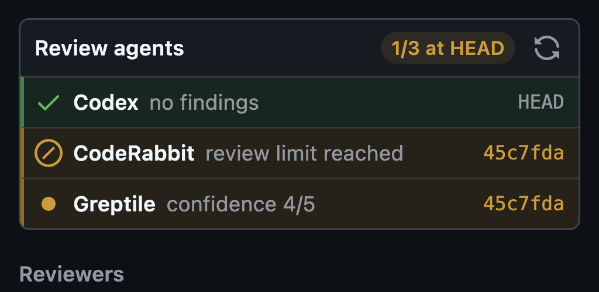
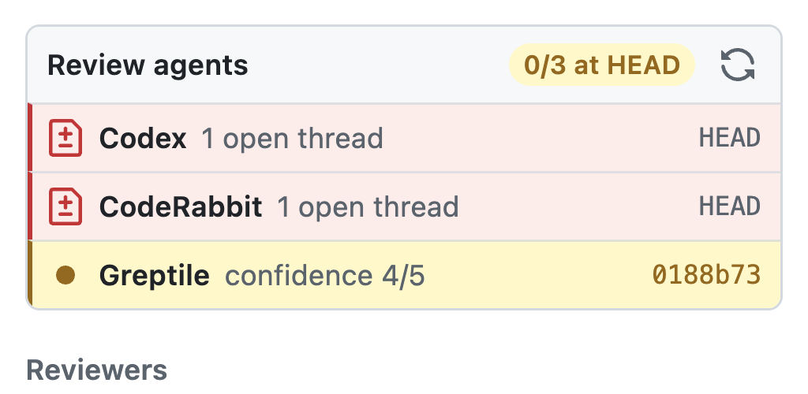

# PR review sign-off

A userscript that adds a **Review agents** table to the Reviewers sidebar of every GitHub pull request. For each AI reviewer (Codex, CodeRabbit, Greptile) it shows whether that reviewer signed off on the PR's **current head commit**, not just at some point in the past.

<table>
  <tr>
    <td></td>
    <td></td>
  </tr>
  <tr>
    <td>Codex signed off on HEAD. CodeRabbit hit its review limit and Greptile reviewed an older commit.</td>
    <td>Codex and CodeRabbit each left an open thread. Greptile reviewed an older commit.</td>
  </tr>
</table>

## Why

Each review bot reports in its own format, and their 👍 reactions and "looks good" comments stay on the PR after you push new commits. In a sample of 14 recent PRs, Greptile's 👍 was on all of them, but on 10 it had reviewed an older commit than HEAD.

The script reads the machine-readable state each bot leaves in its PR comment, compares the commit it reviewed with HEAD, and counts the bot's unresolved review threads.

## What the table shows

| Row | Meaning |
|---|---|
| 🟩 ✓ | Reviewed HEAD, nothing unresolved |
| 🟨 ● | Reviewed an older commit |
| 🟨 ⟳ | Review still running on HEAD |
| 🟨 ⊘ | Review skipped, e.g. CodeRabbit's review limit |
| 🟨 ? | The bot is on the PR, but its state couldn't be read |
| 🟥 | Open review threads or unresolved findings |

- The right column shows `HEAD` or the commit the agent actually reviewed.
- The pill in the header counts the agents that signed off at HEAD.
- Hover a row for details (risk level, outdated threads, reviewed commit vs HEAD). Click it to jump to the bot's comment.
- Agents that never ran on the PR are listed under "Not run".
- Any other bot with unresolved review threads, such as GitHub code scanning, gets a red row.
- On tabs without the sidebar (Files changed, Commits) the table sits at the top of the page.

## Install

1. Install [Tampermonkey](https://www.tampermonkey.net/) or [Violentmonkey](https://violentmonkey.github.io/). In Chrome-based browsers, open `chrome://extensions`, then Tampermonkey → Details, and turn on **Allow User Scripts** (older versions: **Developer mode**).
2. Open **[pr-review-signoff.user.js](https://github.com/sdlyy/pr-review-signoff/raw/main/pr-review-signoff.user.js)** and click **Install**. Updates come from this repo automatically.
3. Open any PR, click **Set token** in the table, and paste a GitHub token.

### Token

GitHub's GraphQL API needs a token even for public repos.

- **Public repos:** a [fine-grained token](https://github.com/settings/personal-access-tokens/new) with read-only access to public repositories should be enough. So far the script has only been tested with the GitHub CLI's token.
- **Private repos:** give the token read-only access to those repos' pull requests, contents and commit statuses. Not tested yet.

The token is kept in your userscript manager's storage and sent only to `api.github.com`. To change it, use **Set GitHub token** in the manager's menu.

## Supported agents

| Agent | Bot account | What it reads |
|---|---|---|
| Codex | `chatgpt-codex-connector` | The `codex-review-state:v1` JSON in its summary comment: reviewed commit, status, unresolved findings |
| CodeRabbit | `coderabbitai` | `final_review_risk_coverage` (reviewed commit) and the "Merge Risk" label in its summary comment, "Review limit reached" and "Review skipped" notices, the `CodeRabbit` check run on HEAD |
| Greptile | `greptile-apps` | `greptile_confidence_score` and the "Last reviewed commit" link in its summary comment, the `Greptile Review` check run on HEAD |

For every agent it also counts the unresolved review threads it opened. Reactions are ignored because they don't say which commit they're for.

A row's verdict is the first match in this list:

1. A review is running on HEAD: **running**
2. Unresolved findings or open threads: **findings**
3. The reviewed commit is HEAD: **signed off**
4. The review was skipped: **skipped**
5. An older commit was reviewed: **stale**
6. Anything else: **unknown**

## Adding an agent

Add an entry to `AGENTS` in [`pr-review-signoff.user.js`](pr-review-signoff.user.js):

```js
{ name: 'MyBot', login: 'mybot-app', check: 'MyBot Review', parse: parseMyBot },
```

`parse(comments)` receives the bot's PR comments, oldest first, and returns `{ sha, detail, url, findings?, skipped?, running? }`. Then record a PR where the bot ran and add a test case for it.

## Development

There are no dependencies. You need Node 20 or newer.

```sh
npm test                                                          # parser tests against recorded PRs
GH_TOKEN=$(gh auth token) npm run record -- l2beat/l2beat 13915   # record a PR as a test fixture
```

Fixtures in [`test/fixtures`](test/fixtures) are trimmed GraphQL responses from public [l2beat/l2beat](https://github.com/l2beat/l2beat) PRs. They keep only bot data, and only the comment lines the parsers read. The recorder refuses to write a fixture whose summary differs from the live PR's.

To try a change in the browser, paste the script into your userscript manager and reload a PR.

## Limitations

- The markers are undocumented bot internals. When a bot changes its format, its row turns ❓ rather than ✅, and the parser needs an update.
- Only the first 100 and last 50 PR comments and the first 100 review threads are read. Bigger PRs may miss data.
- Placement depends on GitHub's sidebar markup. If that changes, the table falls back to the top of the page.
- github.com only, no GitHub Enterprise Server.

## License

[MIT](LICENSE)
